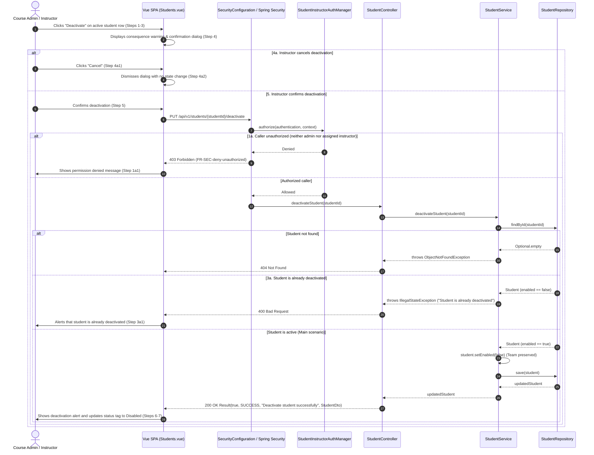

# Student (STU) Design

> Realizes: UC-STU-deactivate-student
> Depends on: BR-student-lifecycle, BR-section-scoped-access, BR-submission-owed, BR-team-admin-only, FR-SEC-active-account, FR-SEC-authorization, FR-SEC-deny-unauthorized
> See: [use cases](../requirements/use-cases.md#student), [SRS security requirements](../requirements/software-requirements-specification.md#security-requirements), [architectural-design.md](architectural-design.md) (shared-foundation component view, Crosscutting Concepts)
> Designed against `main` (2026-11-06).

## Overview

This area governs student lifecycle management within Project Pulse course sections. Prior to this design, deactivation was only an unconfirmed status switch inside the student edit dialog (`EditStudentForm.vue`) dispatched through generic `StudentService.updateStudent`, flipping the `enabled` flag with no warning of consequences, no confirmation, and no lifecycle event semantics. Furthermore, the codebase was inconsistent on the effects of deactivation: reminders excluded inactive students (`BR-submission-owed`), but peer evaluation submission and reporting still presented and included inactive teammates.

This design introduces an explicit, guarded deactivation lifecycle flow: a dedicated action in `Students.vue`, an explanatory consequence warning dialog with cancellation support, a dedicated REST endpoint `PUT /api/v1/students/{studentId}/deactivate` guarded by course admin or section instructor authorization (`StudentInstructorAuthorizationManager`), preservation of the student's team membership and historical submissions (`BR-team-admin-only`, `BR-student-lifecycle`), and visual/submission exclusion of the deactivated student from subsequent peer evaluations (`SubmitTeamsEvaluations.vue`, `EvaluationService.addPeerEvaluation`).

## Components & classes

```mermaid
classDiagram
    direction TB
    class StudentsVue {
        <<reused, modified>>
        +showDeactivateDialog(student)
        +confirmDeactivate(studentId)
    }
    class EditStudentFormVue {
        <<reused, modified>>
        -statusSwitch (removed)
    }
    class StudentApi {
        <<reused, modified>>
        +deactivateStudent(studentId)
    }
    class StudentController {
        <<reused, modified>>
        +deactivateStudent(studentId) Result
    }
    class StudentService {
        <<reused, modified>>
        +deactivateStudent(studentId) Student
    }
    class StudentRepository {
        <<reused, unmodified>>
        +findById(id)
        +save(student)
    }
    class SecurityConfiguration {
        <<reused, modified>>
        +requestMatchers(PUT /students/{studentId}/deactivate)
    }
    class StudentInstructorAuthorizationManager {
        <<reused, unmodified>>
        +authorize(auth, context)
    }
    class EvaluationService {
        <<reused, modified>>
        +addPeerEvaluation(peerEvaluation)
        +generateWeeklyPeerEvaluationReportForSection(sectionId, week)
    }

    StudentsVue --> StudentApi
    StudentApi --> StudentController
    StudentController --> StudentService
    StudentService --> StudentRepository
    SecurityConfiguration --> StudentInstructorAuthorizationManager
    StudentController ..> SecurityConfiguration : guarded by
    EvaluationService --> StudentRepository
```

- **Backend Controller:** [`backend/src/main/java/team/projectpulse/student/StudentController.java`](../../backend/src/main/java/team/projectpulse/student/StudentController.java) (reused, modified) — exposes `PUT /api/v1/students/{studentId}/deactivate`.
- **Backend Service:** [`backend/src/main/java/team/projectpulse/student/StudentService.java`](../../backend/src/main/java/team/projectpulse/student/StudentService.java) (reused, modified) — implements `deactivateStudent(studentId)`: checks existence, validates active precondition, flips `enabled` to `false` without modifying team association, and persists.
- **Backend Repository:** [`backend/src/main/java/team/projectpulse/student/StudentRepository.java`](../../backend/src/main/java/team/projectpulse/student/StudentRepository.java) (reused, unmodified).
- **Backend Security:** [`backend/src/main/java/team/projectpulse/security/SecurityConfiguration.java`](../../backend/src/main/java/team/projectpulse/security/SecurityConfiguration.java) (reused, modified) — configures route authorization on `PUT /api/v1/students/{studentId}/deactivate` using `AuthorizationManagers.anyOf(hasAuthority("ROLE_admin"), studentInstructorAuthorizationManager)`.
- **Backend Authorization Manager:** [`backend/src/main/java/team/projectpulse/security/authorizationmanagers/StudentInstructorAuthorizationManager.java`](../../backend/src/main/java/team/projectpulse/security/authorizationmanagers/StudentInstructorAuthorizationManager.java) (reused, unmodified) — checks if caller is an assigned instructor of the student's course section.
- **Backend Evaluation Service:** [`backend/src/main/java/team/projectpulse/evaluation/EvaluationService.java`](../../backend/src/main/java/team/projectpulse/evaluation/EvaluationService.java) (reused, modified) — prevents submitting evaluations targeting a deactivated student in subsequent weeks; excludes inactive students with no evaluations from weekly section reports.
- **Frontend View:** [`frontend/src/pages/students/Students.vue`](../../frontend/src/pages/students/Students.vue) (reused, modified) — adds dedicated Deactivate action button per active row, consequence warning dialog, and confirmation flow.
- **Frontend Form:** [`frontend/src/pages/students/EditStudentForm.vue`](../../frontend/src/pages/students/EditStudentForm.vue) (reused, modified) — removes silent raw `Status` switch.
- **Frontend API Client:** [`frontend/src/apis/student/index.ts`](../../frontend/src/apis/student/index.ts) (reused, modified) — adds `deactivateStudent(studentId: number)`.
- **Frontend Evaluation Form:** [`frontend/src/pages/evaluations/SubmitTeamsEvaluations.vue`](../../frontend/src/pages/evaluations/SubmitTeamsEvaluations.vue) (reused, modified) — filters out inactive teammates from peer evaluation forms.

## Sequence

### UC-STU-deactivate-student: Main Success Scenario and Extensions



## API contract

| Endpoint or job | Caller (who may) | Request | Success | Errors, by extension |
|---|---|---|---|---|
| `PUT /api/v1/students/{studentId}/deactivate` | Course admin (`ROLE_admin`) OR instructor assigned to student's course section | Path: `studentId` (Integer)<br>Body: None | `200 OK`<br>`Result(true, 200, "Deactivate student successfully", StudentDto)` | **401 Unauthorized**: unauthenticated<br>**403 Forbidden**: caller is not course admin or assigned instructor (Extension 1a)<br>**404 Not Found**: student ID does not exist<br>**400 Bad Request**: student is already deactivated (Extension 3a) |

## Key decisions

- **KD-STU-team-retention (Preserve team assignment on deactivation):** Deactivating a student flips `enabled = false` but leaves `student.team` intact.
  - *Rejected:* Clearing team assignment (`student.setTeam(null)`).
  - *Why:* `BR-team-admin-only` restricts assigning or removing students from a team exclusively to course admins; allowing an instructor to remove a student via deactivation violates that rule. In addition, retaining team membership preserves historical team continuity and allows seamless reactivation without requiring manual team reassignment.
- **KD-STU-peer-eval-omission (Teammate peer evaluation exclusion):** Deactivated students are visually excluded from peer evaluation forms for subsequent weeks (`SubmitTeamsEvaluations.vue`) and rejected in `EvaluationService.addPeerEvaluation`. Weekly section reports omit inactive students who have no evaluations in that week.
  - *Rejected:* Retaining deactivated students in evaluation forms and report rosters.
  - *Why:* Teammates do not owe evaluations of an inactive student (`BR-submission-owed`), and forcing students to rate withdrawn teammates causes confusion and generates spurious zero scores.
- **KD-STU-session-expiration (Stateless bearer token expiration):** Deactivation immediately sets `enabled = false` in the database, blocking subsequent HTTP Basic logins (`MyUserPrincipal.isEnabled()`). Active JWT tokens expire naturally at their standard expiration (up to 2 hours), permitting in-progress work to complete.
  - *Rejected:* Introducing an immediate database check or blacklist on every stateless bearer token request.
  - *Why:* Project Pulse's architecture relies on stateless JWT authentication (`SessionCreationPolicy.STATELESS`). Adding per-request database lookups or token revocation tables would defeat the stateless scaling model for a rare lifecycle event.
- **KD-STU-dedicated-endpoint (Dedicated deactivation route and UI):** Introduce an explicit `PUT /api/v1/students/{studentId}/deactivate` endpoint and a dedicated table action with consequence warning and confirmation dialog in `Students.vue`, while removing the raw status switch from `EditStudentForm.vue`.
  - *Rejected:* Retaining the generic `PUT /api/v1/students/{studentId}` status switch.
  - *Why:* The generic edit endpoint does not prompt for confirmation or display consequence warnings, allowing accidental deactivations that bypass the use case flow.
- **KD-STU-auth-rule (Authorization guard):** Secure the deactivation route with `AuthorizationManagers.anyOf(AuthorityAuthorizationManager.hasAuthority("ROLE_admin"), studentInstructorAuthorizationManager)`.
  - *Rejected:* Using `UserOwnershipAuthorizationManager`.
  - *Why:* `UserOwnershipAuthorizationManager` permits `isStudentSelf`, which would allow a student to deactivate her own account. Only course admins and instructors assigned to the section may execute deactivations.

## Data model

No database schema delta is required. The design reuses the existing `PeerEvaluationUser.enabled` column and `Student.team` many-to-one relationship mapped in the relational database.

## Reuse & cross-cutting

- **Security & Authorization:** Reuses Spring Security OAuth2 resource server, `StudentInstructorAuthorizationManager`, and `FR-SEC-deny-unauthorized` handling.
- **Foundation Models:** Reuses `StudentRepository`, `StudentDto`, and standard `Result` response envelopes.
- **Submission Tracking:** Integrates with `BR-submission-owed` and `SubmissionStatusService` to maintain consistent submission-owing calculations.

## Tests

| Use case, flow | Level (unit / integration) | Asserts |
|---|---|---|
| `UC-STU-deactivate-student`, Main success scenario | Unit (`StudentServiceTest.testDeactivateStudentSuccess`) | Deactivates student, sets `enabled = false`, preserves team membership, calls `save`, returns updated student. |
| `UC-STU-deactivate-student`, Extension 3a (already inactive) | Unit (`StudentServiceTest.testDeactivateStudentAlreadyDeactivatedThrowsException`) | Calling `deactivateStudent` on inactive student throws `IllegalStateException("Student is already deactivated")`. |
| `UC-STU-deactivate-student`, Student not found | Unit (`StudentServiceTest.testDeactivateStudentNotFoundThrowsException`) | Calling `deactivateStudent` on nonexistent ID throws `ObjectNotFoundException`. |
| `UC-STU-deactivate-student`, Main scenario (admin caller) | Integration (`StudentIntegrationTest.testAdminDeactivatesStudentSuccess`) | Course admin calls `PUT /api/v1/students/{id}/deactivate`; returns `200 OK`, `enabled == false`, team remains assigned in DB. |
| `UC-STU-deactivate-student`, Main scenario (assigned instructor) | Integration (`StudentIntegrationTest.testAssignedInstructorDeactivatesStudentSuccess`) | Assigned instructor calls `PUT /api/v1/students/{id}/deactivate`; returns `200 OK`, `enabled == false`. |
| `UC-STU-deactivate-student`, Extension 1a (unassigned instructor) | Integration (`StudentIntegrationTest.testUnassignedInstructorDeactivatesStudentForbidden`) | Instructor not assigned to section calls `PUT /api/v1/students/{id}/deactivate`; returns `403 Forbidden`. |
| `UC-STU-deactivate-student`, Extension 1a (student caller) | Integration (`StudentIntegrationTest.testStudentDeactivatesSelfForbidden`) | Student calls `PUT /api/v1/students/{id}/deactivate` on own ID; returns `403 Forbidden`. |
| `UC-STU-deactivate-student`, Extension 3a (already inactive API) | Integration (`StudentIntegrationTest.testDeactivateAlreadyInactiveStudentReturnsBadRequest`) | Calling deactivate on already inactive student returns `400 Bad Request`. |
| `UC-STU-deactivate-student`, Extension 4a (instructor cancels confirmation) | Frontend flow (`Students.vue`) | Canceling the confirmation warning dismisses dialog with no state change; dispatches no HTTP request and student remains active. |
| Teammate peer evaluation exclusion | Unit (`EvaluationServiceTest.testAddPeerEvaluationForDeactivatedStudentThrowsException`) | Submitting peer evaluation for deactivated evaluatee in subsequent week throws `PeerEvaluationIllegalArgumentException`. |
| Teammate peer evaluation form exclusion | Frontend flow (`SubmitTeamsEvaluations.vue`) | Inactive teammates are excluded from the peer evaluation form roster. |
| Section report omission | Unit (`EvaluationServiceTest.testGenerateWeeklyPeerEvaluationReportExcludesInactiveStudentWithNoEvals`) | Inactive student with no evaluations in target week is excluded from section report. |

## Open questions / risks

- **Stateless token validity window:** A deactivated student with an existing JWT token can continue calling protected API endpoints until that token expires (up to 2 hours). Accepted per `KD-STU-session-expiration` to maintain the stateless architecture and allow in-progress work to finish.
